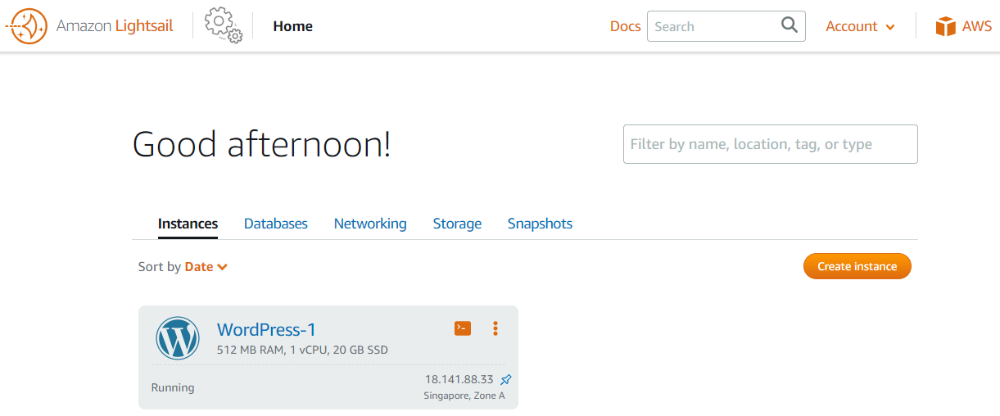
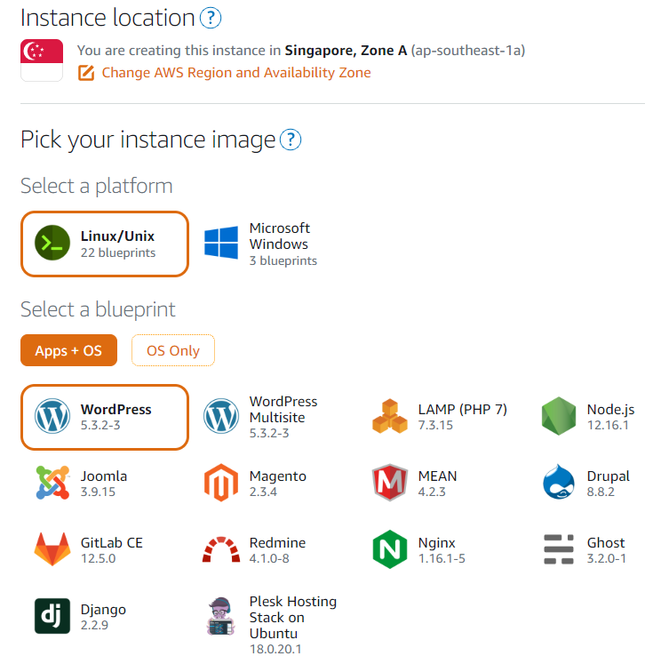
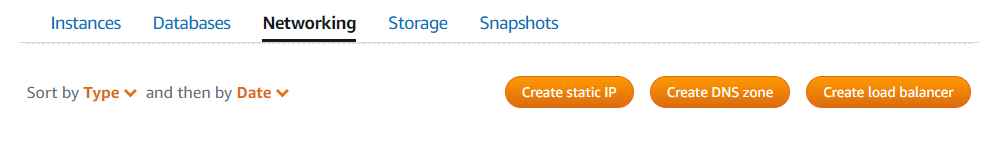
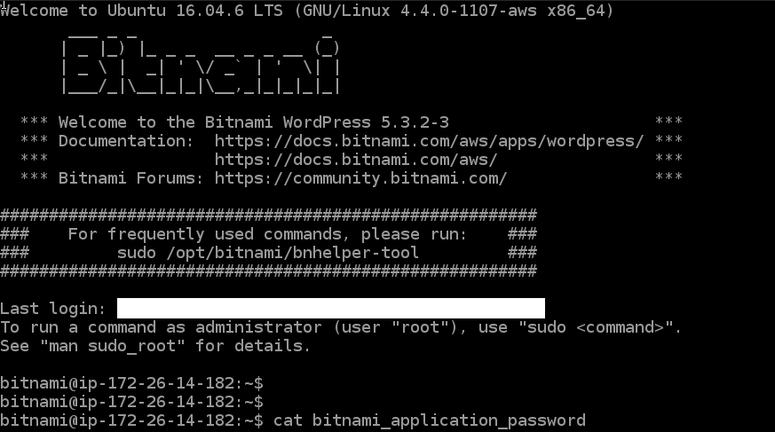
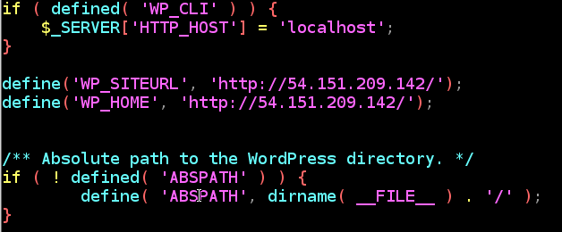

::: {.callout-note}
## Historical tutorial
Originally published in May 2020. Screenshots, prices, console navigation, and Bitnami paths describe the setup at that time and have not been checked against the current service. In this article, “VPN” is an old wording error: the steps concern a virtual server instance.
:::

{width=500}

Some programming hobby. Let's attempt to build a [wordpress](https://wordpress.com/) website using [Amazon Lightsail](https://aws.amazon.com/lightsail/). This is an easy tutorial and we should be able to build it in less than 10 minutes.

### Sign Up for Amazon AWS

First of course, head over to [Amazon AWS](https://aws.amazon.com/) and sign yourself up! You'll be prompted to give a credit card, but if used right the charges should be minimal.
After that, you'll be prompted with the AWS management console. On the "find services" tab, put in "Amazon Lightsail". You'll be shown the lightsail page.

{width=800}

### Creating a wordpress instance

To create a VPN instannce, just click on "create an instance", then choose an instance location (usually it is default to whichever closest to your current location). Select "linux/unix" platform, and select a blueprint "wordpress".
In this case the VPN will be pre-installed with Linux and [Bitnami](https://bitnami.com/stack/wordpress) version of wordpress.

{width=450}

Scroll further downwards and you'll be presented with choices, such as launch script or SSH key pairs. You'll be fine not doing any of them for now. Also you can choose your instance plan. For starter, let's use the cheapest $3.5 plan. It'll generally work for websites with low volumes.
Finally click on "create instance".

### Assign a static address

Next, we'll need to assign a static address to the VPN instance. It's free of charge, as long as you keep the VPN server up and running. To do that, go to the "lightsail" page, then choose "networking".
Next click on "create static IP". Remember to attach the IP to the VPN instance you've just created. Oh yes, remember the IP address!

{width=800}

### Get admin password and login

We're not there yet! Now you'll need to login into the wordpress. To do that, you'll need a user/password. The fastest way to get your password is via SSH connection to your VPN server. To do that, go back to the lightsail page, on your VPN instance, click on the SSH button.
The remote SSH session should start. Now type in the following
```python
cat bitnami_application_password
```

{width=800}

Your user will be "user" with the password displayed. To login, just go to your wordpress using the static IP address previously, and click on the login button on the lower right corner.

### Connecting a domain name to the host.

No one will connect to your website via an IP address (well, try memorizing it). Anyway, I assume you have a domain bought. To redirect the domain to your static IP address, just add an "A record" with host "@" and value being the static IP address.

After that, you'll need to also configure wordpress to [redirect](https://docs.bitnami.com/bch/apps/wordpress/administration/configure-domain/) to the right domain name. To do that, connect to your VPN's SSH session, then go to 
```python
/opt/bitnami/apps/wordpress/htdocs/wp-config.php
```

And change the field "define('WP_SITEURL') and ('WP_HOME')" to your domain name. You're done!

{width=500}