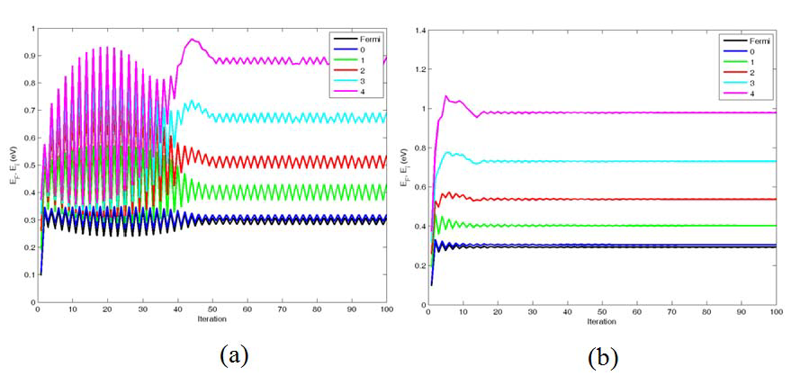
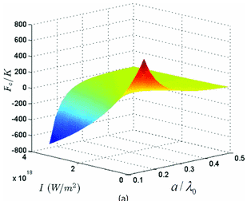
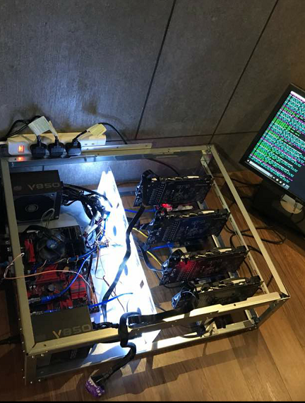

A selection of projects from my previous website, spanning quantitative finance, physics, and programming experiments. Some are historical projects whose code is not available here.

## Quantitative finance

### A parallel Monte Carlo framework in C#

An object-oriented Monte Carlo framework for derivative pricing, designed to reuse stochastic processes and product definitions and distribute simulations across parallel workers. The original project proposed a European option comparison and applications to path-dependent products. The accompanying note and source files are not included in this archive.

### Bootstrapping a SOFR curve

A QuantLib exploration of constructing an overnight-indexed swap curve and repricing its calibration instruments.

[Read the SOFR curve note](notes/sofr-curve/index.qmd).

## Physics

### Self-consistent calculations in silicon nanostructures

An iterative calculation of electron eigenfunctions and energies in a silicon inversion layer, developed in collaboration with Dr G. Gopir. The work coupled electrostatic and quantum calculations and explored adaptive boundary conditions to improve convergence. The previous website records publication in *Solid State Science and Technology*, **20**, 88–95.

{width=500}

### Controlling the repulsive Casimir force

Theoretical work with Prof C. H. Raymond Ooi on varying the Casimir force between parallel plates through the optical Kerr effect. The calculations explored how changing incident laser intensity could change the force between attraction and repulsion for suitable materials.

The work appeared in [Physical Review A, **86**, 062509](https://doi.org/10.1103/PhysRevA.86.062509) and [Sains Malaysiana, **42**(12), 1799–1803](https://www.ukm.my/jsm/pdf_files/SM-PDF-42-12-2013/17%20Y.Y.%20Khoo.pdf). The original code is in the [Casimir force repository](https://github.com/yykhoo88/ControllingRepulsiveCasimirForce).

{width=500}

## Other experiments

### A compartmental model experiment

A 2020 exploration of an SEIR model using forward Euler integration. The original notebook is retained as a historical experiment, with a migration note identifying an inconsistency in its parameterisation.

[Read the archived notebook](archive/seir-model/index.qmd).

### Blackjack simulation

An early Python simulation of blackjack. The previous website described the player strategy as unfinished. The source and downloads are not included in this project.

### A GPU mining rig

A historical hardware project using four GTX 1070 Ti graphics cards. This entry records the original build rather than providing a current mining guide.

{width=550}
